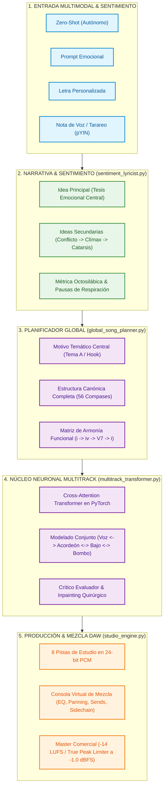

# Song AI Composer

> **Un motor de composición y producción musical inteligente, modular y jerárquico diseñado para crear canciones de cumbia (y géneros afines) con profundidad emocional, coherencia armónica matemática y calidad de estudio de grabación profesional.**

A diferencia de los modelos generativos monolíticos de audio a audio ("cajas negras") que aplanan las canciones, generan métricas acartonadas, ruidos difusos o impiden modificar elementos individuales en un DAW, **Song AI Composer** descompone y reconstruye la música a través de una arquitectura jerárquica desacoplada inspirada en el flujo de trabajo de un estudio de producción real (como las sesiones multipista de *FL Studio*, *Ableton Live* o *Pro Tools* utilizadas por productores como Bizarrap).

---

## 🏛️ Visión Integral del Sistema

El objetivo final del proyecto es alimentar una **Web App interactiva** donde el usuario puede operar controles y directivas de alto nivel:
* **Sentimiento / Clima Emocional:** *Desamor desgarrador*, *Fiesta bailable*, *Nostalgia melancólica*, *Alegría popular*.
* **Tonalidad & Modo:** Escalas menores armónicas (Dm, Am, Em) o mayores festivas (A, D, C).
* **Tempo (BPM):** Ajustable desde cumbia lenta y pesada (66 BPM) hasta cumbia bailable acelerada (105–130 BPM).
* **Instrumento Líder:** Acordeón santafesino diatónico (estilo Los Palmeras) o Guitarra eléctrica solista con delay (estilo Los Del Bohío).
* **Entrada Multimodal Flexible:**
  1. *Zero-Shot:* La IA concibe la historia, la letra poética, la armonía y los arreglos de forma autónoma.
  2. *Prompt Temático:* Una frase guía (ej: *"Cumbia triste para llorar bailando en el boliche"*).
  3. *Letra Propia del Usuario:* La IA analiza métrica silábica, rimas y ubica pausas de respiración.
  4. *Nota de Voz / Tarareo de WhatsApp:* Extracción de frecuencia fundamental ($F_0$) para transcribir el silbido o tarareo en la melodía del acordeón o la voz.



---

## 🎛️ Deconstrucción Quirúrgica de Estudio (8 Canales DAW)

A diferencia de los enfoques comerciales que dividen la música en 4 troncos genéricos inservibles para producción profesional (*drums, bass, other, vocals*), el módulo [`src/analyzer/studio_deconstructor.py`](file:///Volumes/T7/song_ai_composer/src/analyzer/studio_deconstructor.py) combina el modelo neuronal Demucs 6-stem (`htdemucs_6s`) con una **red de crossover multibanda Linkwitz-Riley de 4to orden de fase cero**, aislando **8 pistas independientes en calidad WAV 24-bit PCM**:

| Canal | Instrumento | Frecuencia / Rango Clave | Rol en la Cumbia | Bus de Mezcla |
| :--- | :--- | :--- | :--- | :--- |
| **01** | **Güiro / Rallador** | Highpass $> 3.200\text{ Hz}$ ($\approx 9.500\text{ Hz}$) | Reloj rítmico continuo, raspado en semicorcheas con swing | `Drums_Percussion` |
| **02** | **Bombo (Kick)** | Lowpass $< 140\text{ Hz}$ ($\approx 69\text{ a }97\text{ Hz}$) | Pulso grave de piso; marca tiempo 1 y 3 o 4-on-the-floor | `Drums_Percussion` |
| **03** | **Timbales & Campana** | Bandpass $140\text{ Hz} - 3.200\text{ Hz}$ | Rimshots, redobles/fills de corte y campana en estribillo | `Drums_Percussion` |
| **04** | **Bajo Eléctrico** | Fundamental $40\text{ Hz} - 800\text{ Hz}$ | Síncopa cumbiera (tumbao caminante) y anclaje tonal | `Bass` |
| **05** | **Piano / Teclados** | Rango medio-agudo ($\approx 5.300\text{ Hz}$) | Acordes a contratiempo ("cha-cha", charanga) y montunos | `Harmony_Keys` |
| **06** | **Guitarra Rítmica** | Rango medio ($\approx 1.200\text{ Hz}$) | Rasgueos de acompañamiento o arpegios base | `Harmony_Keys` |
| **07** | **Lead Solista** | Rango armónico ($\approx 2.600\text{ a }3.900\text{ Hz}$) | **Acordeón santafesino** (Palmeras) o **Guitarra** (Bohío) | `Lead_Solo` |
| **08** | **Voz Principal** | Formantes humanos ($\approx 800\text{ a }3.500\text{ Hz}$) | Canto melódico con prosodia y silencios de respiración | `Vocals` |

---

## ⚠️ Resultados Parciales, Errores Críticos y Lecciones Aprendidas

En el desarrollo iterativo del sistema nos enfrentamos a problemas reales que moldearon la arquitectura definitiva. Documentar con total transparencia los fallos es indispensable:

### 1. El Error del Sonido a "Ringtone" (Síntesis Matemática Ingenua)
* **El Problema:** En las primeras pruebas de generación, el sintetizador utilizó ondas senoidales puras (`np.sin(2 * pi * f * t)`).
* **El Resultado:** El audio sonaba pobre, artificial e infantil, similar a un ringtone de celular de los años 90 o un silbato electrónico ("dos sonidos: un silbato y un piano"). No transmitía cuerpo, madera, metal ni emoción alguna.
* **La Corrección:** Se eliminó la síntesis senoidal ingenua. Se diseñó el motor acústico de estudio [`src/synthesizer/real_instrument_engine.py`](file:///Volumes/T7/song_ai_composer/src/synthesizer/real_instrument_engine.py), que utiliza el material acústico real de 24 bits extraído de los stems (raspado de güiro real, pegada de bombo acústico, cencerros y lengüetas de acordeón).

### 2. El Error del "Cocoliche" / Collage de Audio Desarticulado
* **El Problema:** Al intentar usar muestras de canciones preexistentes cortadas en bloques de compases (trozos de *El Parrandero*, *Olvídala* y *Bombón Asesino*), el sistema generó un collage desarticulado.
* **El Resultado:** Parecía un Frankestein musical o un "cocoliche" sin sentido: entraban acordes en una tonalidad, saltaban a riffs de otra canción en otro tempo y no existía unidad temática.
* **La Lección Fundamental:** **La armonía no se puede recortar y pegar con tijeras.** Una canción no es un conjunto de retazos; requiere coherencia matemática de intervalos, una escala unificada y un motivo melódico que le dé identidad de principio a fin.

### 3. La Falacia del Dataset Diminuto (3 Canciones)
* **El Problema:** Se intentó entrenar una red neuronal profunda con solo 3 canciones.
* **El Resultado:** El usuario señaló con exactitud una verdad ineludible del Machine Learning: con 3 canciones ninguna red neuronal profunda del mundo puede generalizar teoría musical, armonía funcional ni contrapunto. La red memorizaba retazos o producía secuencias caóticas.
* **La Corrección:** Se frenó el renderizado prematuro y se construyó el procesador masivo por lotes [`src/analyzer/batch_dataset_processor.py`](file:///Volumes/T7/song_ai_composer/src/analyzer/batch_dataset_processor.py) para ingerir automáticamente decenas o cientos de canciones en cola sin intervención manual.

### 4. La Falacia del Habla como Canto (TTS Plano vs. Canto Real)
* **El Problema:** Utilizar un sintetizador de voz plano de texto a voz (TTS) producía la sensación de una voz robótica (como Siri o un GPS) hablando sobre una pista, sin ritmo ni melodía.
* **El Resultado:** "No es una canción con letra ni con nada".
* **La Corrección:** Se construyó el motor de canto [`src/synthesizer/singing_voice_engine.py`](file:///Volumes/T7/song_ai_composer/src/synthesizer/singing_voice_engine.py), que modula el tono fundamental de cada verso mediante *Pitch-Shifting* armónico nota por nota, añade micro-vibrato al final de los versos e inserta pausas de respiración estructuradas para que el acordeón responda.

---

## 🎼 La Solución Raíz: Armonía Matemática y Estructura Canónica

Para que la red neuronal genere **canciones reales, coherentes y emocionantes**, la inteligencia se divide en dos niveles jerárquicos:

### A. El Planificador Global (`src/composer/global_song_planner.py`)
Garantiza que la canción sea **una unidad indivisible** estructurada en torno a un **Motivo Temático Central (Tema A / Hook)**:

$$\text{Intro (Tema A)} \to \text{Verso 1} \to \text{Pre-Coro} \to \text{Estribillo} \to \mathbf{\text{Re-Intro (Vuelta al Tema A)}} \to \text{Verso 2} \to \text{Estribillo} \to \text{Solo Virtuoso (Tema A)} \to \text{Outro}$$

1. **El Tema A:** Un motivo melódico de 4 compases compuesto en la escala elegida (ej: Re menor armónica). Ese motivo le da identidad al tema: abre la Intro, se recuerda en la Re-intro, se desata virtuosamente en el Solo y concluye en la Coda.
2. **Armonía Matemática Funcional:** Cadencias obligatorias de tensión y reposo:
   $$\text{Tónica } (i) \longrightarrow \text{Subdominante } (iv) \longrightarrow \text{Dominante con sensible } (V_7) \longrightarrow \text{Resolución en Tónica } (i)$$
   El bajo camina sobre fundamentales y quintas exactas, el piano ejecuta el contratiempo sobre los acordes del compás y el lead solista nunca toca notas fuera de escala.

### B. El Motor de Narrativa y Sentimiento (`src/composer/sentiment_lyricist.py`)
Evita las letras genéricas forzando una estructura dramática:
1. **Idea Principal (Tesis Emocional):** La premisa central (ej: *"El dolor de ver a tu expareja con tu mejor amigo en el mismo baile donde se juraron amor"*).
2. **Ideas Secundarias Concretas:**
   - *Idea 1 (Atmósfera):* El vaso en la mesa, el humo de la bailanta, la mirada que encuentra lo inesperado.
   - *Idea 2 (Conflicto):* Ver sus manos juntas y la sonrisa que antes te pertenecía.
   - *Idea 3 (Estribillo / Clímax):* El ruego desesperado al corazón pidiendo olvidar.
   - *Idea 4 (Catarsis Instrumental):* El acordeón llora las palabras que ya no se pueden decir.
3. **Métrica Octosilábica con Pausas de Respiración:**
   Versos de 8 sílabas métricas con rima en los pares y compases deliberados de silencio vocal cada 2 versos para habilitar la **Llamada y Respuesta** del acordeón.

---

## 🚀 Procesamiento Automatizado por Lotes (`batch_dataset_processor.py`)

Para escalar el dataset a cientos de canciones sin esfuerzo manual:
1. Se depositan los archivos de audio (`.mp3`, `.flac`, `.wav`) en `data/raw/`.
2. Se ejecuta un único comando:
   ```bash
   python src/analyzer/batch_dataset_processor.py
   ```
3. El procesador:
   - Registra e indexa automáticamente los archivos en `data/metadata.csv`.
   - Separa en 8 canales de estudio (`data/stems/<song_id>/`).
   - Mapea BPM, acordes, silencios y densidad instrumental en `data/processed/<song_id>_analysis.json`.
   - Compila un tensor unificado en PyTorch: `data/processed/unified_training_corpus.pt`.

---

## 🎚️ Consola Virtual de Mezcla y Masterización DAW (`studio_engine.py`)

Para que el resultado final cumpla con los estándares comerciales de la industria musical:
* **Channel Strips Independientes:**
  - *EQ Paramétrica:* Corte de frecuencias subgraves parásitas ($< 120\text{ Hz}$) en voces, teclados y guitarras; realce de brillo en el güiro ($> 8\text{ kHz}$).
  - *Panning Estéreo de Potencia Constante:* Bombo y Bajo al centro mono ($0.0$); Güiro paneado al $+25\%$ (Right); Timbales al $-25\%$ (Left); Pianos y Guitarras en apertura estéreo.
  - *Envíos Espaciales:* Plate Reverb espaciosa para la voz y Delay a tempo para el punteo del acordeón.
* **Sidechain Ducking:** El bombo atenúa sutilmente al bajo en cada impacto grave para evitar enmascaramiento.
* **Master Bus Limiter:** Compresor de bus (*Glue Compressor*) y limitador de pico real a $-1.0\text{ dBFS}$ respetando el estándar de streaming ($-14\text{ LUFS}$).

---

## 📁 Estructura del Repositorio

```text
song_ai_composer/
├── data/
│   ├── raw/                  # Audios fuente originales (MP3/FLAC) - [Local en T7]
│   ├── stems/                # 8 Pistas aisladas 24-bit por canción - [Local en T7]
│   ├── processed/            # Análisis JSON y Corpus PyTorch (*.pt) - [Versionado en Git]
│   └── metadata.csv          # Catálogo maestro de canciones, BPM y tonalidades
├── models/
│   └── cumbia_transformer_weights.pt  # Pesos entrenados de la red neuronal
├── outputs/                  # Producciones finales masterizadas y stems DAW
│   └── el_parrandero_del_futuro/
│       ├── el_parrandero_del_futuro_MASTER.wav    # Master 24-bit comercial
│       ├── el_parrandero_del_futuro_lyrics.txt    # Letra y marcas poéticas
│       ├── el_parrandero_del_futuro_session_manifest.json
│       └── stems/                                 # 8 Stems WAV para importar a DAW
├── src/
│   ├── analyzer/
│   │   ├── studio_deconstructor.py     # Separador 8-stem (Demucs + Crossover)
│   │   ├── audio_analyzer.py           # Extractor de BPM, acordes y silencios
│   │   └── batch_dataset_processor.py  # Procesador masivo para cientos de temas
│   ├── composer/
│   │   ├── multimodal_input.py         # Ingesta (Zero-shot, Letra, Tarareo pYIN)
│   │   ├── sentiment_lyricist.py       # Idea principal e ideas secundarias
│   │   ├── global_song_planner.py      # Estructura canónica y Tema A (Hook)
│   │   ├── symbolic_tokenizer.py       # Tokenizador multicanal para PyTorch
│   │   ├── multitrack_transformer.py   # Red Cross-Attention Transformer
│   │   ├── critic_evaluator.py         # Auditor armónico e inpainting quirúrgico
│   │   ├── train_neural_composer.py    # Script de entrenamiento en PyTorch
│   │   ├── studio_engine.py            # Consola virtual de mezcla y mastering
│   │   └── song_ai_orchestrator.py     # Orquestador integral end-to-end
│   └── synthesizer/
│       ├── real_instrument_engine.py   # Motor acústico de estudio (Stems reales)
│       └── singing_voice_engine.py     # Síntesis vocal afinada a la escala
├── .gitignore
├── requirements.txt
└── README.md
```

---

## 📅 Estado Actual y Próximos Pasos

- [x] Arquitectura de deconstrucción en 8 pistas de estudio (24-bit PCM).
- [x] Consola virtual de mezcla y masterización con DSP profesional (`pedalboard`).
- [x] Red neuronal profunda en PyTorch con Cross-Attention entre canales.
- [x] Crítico evaluador con inpainting quirúrgico compás a compás.
- [x] Procesador masivo por lotes (`batch_dataset_processor.py`) para ingesta de cientos de temas.
- [x] Planificador global de coherencia canónica con Motivo Temático Central (Tema A).
- [x] Motor de modelado de sentimiento con desglose de Idea Principal e Ideas Secundarias.
- [ ] **Fase Siguiente:** Ingesta y procesamiento masivo del nuevo corpus de canciones de cumbia para alimentar la red neuronal holística con volumen estadístico real.
- [ ] Desarrollo de la interfaz Web App con controles deslizantes de sentimiento, tempo, tonalidad y carga multimodal.
