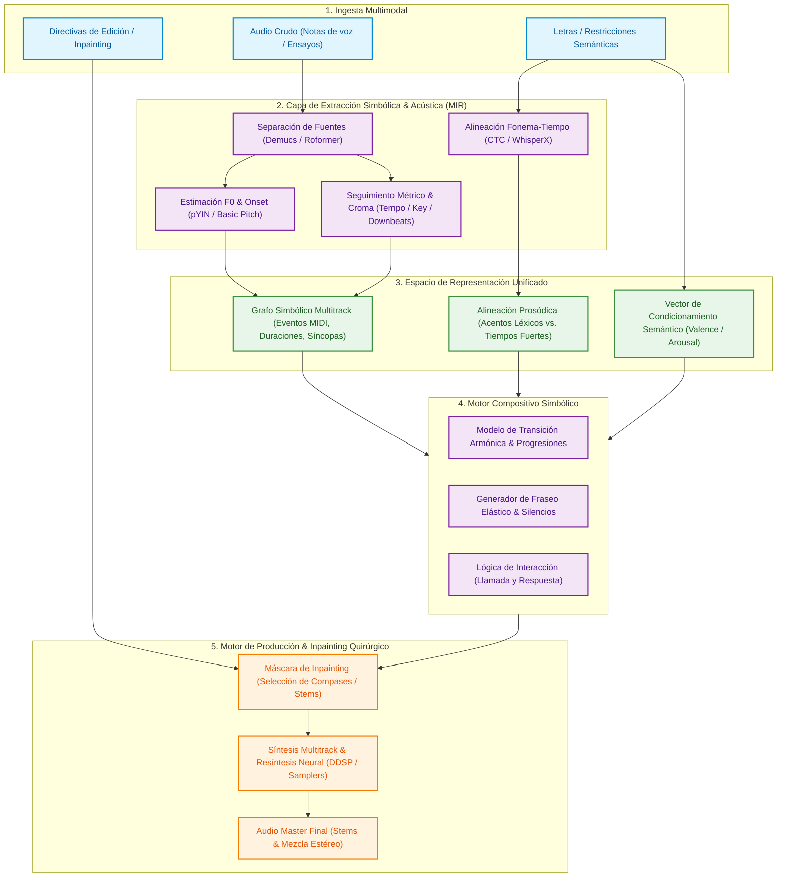

# Song AI Composer

> **Un motor de composición musical inteligente, modular y jerárquico diseñado para crear canciones con profundidad emocional, coherencia armónica y control quirúrgico.**

A diferencia de los modelos generativos monolíticos de audio a audio ("cajas negras") que aplanan las canciones, generan métricas acartonadas o impiden modificar elementos individuales, **Song AI Composer** descompone el arte de la composición en una arquitectura jerárquica de tres niveles inspirada en el flujo de trabajo de un estudio de producción real.

---

## 🏛️ Arquitectura del Sistema

El sistema implementa una canalización jerárquica desacoplada que separa la percepción acústica, el modelado probabilístico de composición y la síntesis neural de audio.



### Especificación Formal de Componentes

| Subsistema | Espacio de Entrada ($\mathcal{X}$) | Modelos / Algoritmos | Espacio de Representación ($\mathcal{Y}$) |
| :--- | :--- | :--- | :--- |
| **Acoustic MIR Pipeline** | Forma de onda discreta $x(t) \in \mathbb{R}^{T}$ | Conv-TasNet / Hybrid Demucs, Basic Pitch | Stems aislados $\{S_{\text{bass}}, S_{\text{perc}}, S_{\text{harm}}, S_{\text{vox}}\}$ |
| **Pitch & Metric Extractor** | Pistas aisladas $S_i(t)$ | pYIN / Mel-Filterbanks, Beat Trackers | Curvas $F_0(t)$, Grid métrico (BPM, Downbeats), Chroma |
| **Prosodic Aligner** | $S_{\text{vox}}(t)$ + Transcripción textual | Wav2Vec2 / CTC Forced Alignment | Matriz de alineación fonema-tiempo $\tau(p_k) \in [t_{\text{start}}, t_{\text{end}}]$ |
| **Composition Engine** | Grafo simbólico + Vector $\mathbf{v}_{\text{emotion}}$ | Probabilistic Sequence Models / Prior Transformers | Matriz de eventos polifónicos (Notas, síncopas, pausas) |
| **Surgical Inpainting** | Stems existentes + Máscara $\mathbf{M} \in \{0, 1\}^{B \times K}$ | Inpainting condicionado por contexto musical | Regeneración localizada de compases $B$ en pistas $K$ |

---

## 📁 Estructura del Repositorio y Almacenamiento Local (Disco T7)

El proyecto utiliza una estrategia híbrida: el código, las reglas analíticas, los datos simbólicos (MIDI) y las alineaciones métricas se versionan en Git, mientras que los gigabytes de archivos de audio de alta resolución residen localmente en el disco externo.

```text
song_ai_composer/
├── data/
│   ├── raw/             # Audios fuente en alta calidad (WAV/MP3) - [Local en T7]
│   ├── stems/           # Pistas aisladas por instrumento - [Local en T7]
│   ├── midi/            # Transcripciones melódicas y armónicas - [Versionado en Git]
│   ├── lyrics/          # Letras, fonética y marcas temporales - [Versionado en Git]
│   ├── processed/       # Matrices de probabilidad y secuencias - [Versionado en Git]
│   └── metadata.csv     # Catálogo con BPM, tonalidad, emoción y métricas
├── src/
│   ├── analyzer/        # Extracción de audio, stems, afinación y prosodia
│   ├── composer/        # Lógica de composición simbólica, armonía y estructura
│   ├── synthesizer/     # Renderizado de audio, producción e inpainting
│   └── utils/           # Herramientas de audio, conversión y descargas
├── outputs/
│   └── audio/           # Canciones y stems generados
├── notebooks/           # Espacio de pruebas y experimentación interactiva
├── .gitignore           # Exclusión de archivos pesados y temporales
└── README.md
```

---

## 🔬 Caso de Estudio Inicial: Calibración y Pruebas Piloto

Para validar y calibrar los algoritmos de extracción y composición antes de escalar masivamente, el sistema se evalúa mediante bancos de prueba controlados:

* **Benchmark Piloto (Fase 1):** Géneros con alta síncopa rítmica, diálogo marcado entre voz e instrumento solista (llamada y respuesta) y fuerte carga emocional (desamor, nostalgia, fiesta). 
  * Se utiliza un conjunto calibrado de **25 a 30 obras de referencia** para probar la extracción de patrones de bajo sincopado, grooves percusivos, dinámicas de acordeón/teclado y prosodia en español.
* **Fases Posteriores:** Integración y cruce de datos con otros géneros musicales para fomentar la hibridación, la originalidad y evitar el sobreajuste estilístico.

---

## 🚀 Hoja de Ruta

- [x] Inicialización del entorno de trabajo y estructura multitrack.
- [x] Configuración del control de versiones y aislamiento de almacenamiento masivo.
- [ ] Pipeline de análisis de audio: Separador de stems + detector de BPM y tonalidad.
- [ ] Módulo de transcripción melódica (Audio-to-MIDI) para notas de voz de entrada.
- [ ] Motor de alineación letra-ritmo (Prosodia y fraseo elástico).
- [ ] Generador simbólico de armonías y melodías con control emocional.
- [ ] Motor de inpainting y modificación por segmentos específicos.
