# Song AI Composer

> **Un motor universal de composición y producción musical inteligente, modular y jerárquico diseñado para crear canciones completas con profundidad emocional, coherencia armónica matemática y calidad de estudio de grabación profesional.**

A diferencia de los modelos generativos monolíticos de audio ("cajas negras") que aplanan las pistas, generan mezclas difusas o impiden modificar elementos individuales, **Song AI Composer** descompone y modela el arte de la producción musical a través de una arquitectura jerárquica desacoplada inspirada en el flujo de trabajo de un estudio de grabación real (como las sesiones multipista de *Ableton Live*, *FL Studio* o *Pro Tools*).

El sistema concibe cada canción como una **unidad orgánica e indivisible**: la emoción no reside en un instrumento aislado, sino en la interacción simultánea y coordinada de todos los canales instrumentales y vocales respondiendo a una misma narrativa y a leyes matemáticas de armonía.

---

## 🏛️ Arquitectura General del Sistema

El sistema opera a través de una canalización estructurada en 5 etapas interconectadas:

```mermaid
flowchart TD
    classDef inputStyle fill:#e1f5fe,stroke:#0288d1,stroke-width:2px,color:#01579b;
    classDef repStyle fill:#e8f5e9,stroke:#388e3c,stroke-width:2px,color:#1b5e20;
    classDef layerStyle fill:#f3e5f5,stroke:#7b1fa2,stroke-width:2px,color:#4a148c;
    classDef prodStyle fill:#fff3e0,stroke:#f57c00,stroke-width:2px,color:#e65100;

    subgraph Inputs["1. INGESTA MULTIMODAL (multimodal_input.py)"]
        InZero["Zero-Shot (Composición Autónoma)"]:::inputStyle
        InPrompt["Prompt Semántico / Emocional"]:::inputStyle
        InLyrics["Letra Personalizada del Usuario"]:::inputStyle
        InAudio["Audio / Nota de Voz / Tarareo (pYIN F0)"]:::inputStyle
    end

    subgraph Narrative["2. NARRATIVA & SENTIMIENTO (sentiment_lyricist.py)"]
        CoreIdea["Idea Principal (Tesis Emocional Central)"]:::repStyle
        SecIdeas["Desglose en Ideas Secundarias (Conflicto -> Clímax -> Catarsis)"]:::repStyle
        PoeticMetric["Métrica Silábica & Pausas de Respiración"]:::repStyle
    end

    subgraph Macro["3. PLANIFICADOR GLOBAL & ARMONÍA (global_song_planner.py)"]
        MotifA["Motivo Temático Central (Tema A / Hook)"]:::layerStyle
        CanonicalForm["Estructura Canónica (Intro -> Verso -> Coro -> Re-Intro -> Solo -> Outro)"]:::layerStyle
        HarmonicMath["Matemática Armónica (Cadencias Funcionales & Voice Leading)"]:::layerStyle
    end

    subgraph NeuralCore["4. NÚCLEO NEURONAL MULTITRACK (multitrack_transformer.py)"]
        MultiStream["PyTorch Multitrack Cross-Attention Transformer"]:::layerStyle
        JointModel["Modelado Conjunto (Interacción Simultánea de Canales)"]:::layerStyle
        CriticInpaint["Crítico Evaluador & Inpainting Quirúrgico (critic_evaluator.py)"]:::layerStyle
    end

    subgraph StudioEngine["5. PRODUCCIÓN & MEZCLA DAW (studio_engine.py)"]
        Stems8["Pistas Individuales de Estudio (24-bit PCM)"]:::prodStyle
        VirtualConsole["Consola Virtual de Mezcla (EQ, Panning, Sends, Sidechain)"]:::prodStyle
        MasterOut["Master Comercial Final (-14 LUFS / True Peak Limiter a -1.0 dBFS)"]:::prodStyle
    end

    Inputs --> Narrative
    Narrative --> Macro
    Macro --> NeuralCore
    NeuralCore --> StudioEngine
```



---

## 🧠 Funcionamiento del Algoritmo

### 1. Ingesta Multimodal Flexible
El sistema admite diversas modalidades de interacción, adaptadas para una futura **Web App**:
* **Zero-Shot:** Si el usuario no proporciona datos, la IA define autónomamente el concepto, la tonalidad, el tempo, la letra y la estructura.
* **Prompt Semántico:** Guía conceptual (ej: *"canción melancólica sobre un amor no correspondido"* o *"tema enérgico de celebración nocturna"*).
* **Letra Personalizada:** Análisis métrico de sílabas, acentuación prosódica y asignación de compases de respiración para evitar saturación vocal.
* **Nota de Voz / Tarareo:** Algoritmo probabilístico de estimación de tono fundamental ($F_0$) vía `pYIN` para transcribir audios de voz en notas musicales cuantizadas.

### 2. Modelado de Sentimiento y Narrativa Lírica
Para que la obra tenga sentido conceptual y transmita un sentimiento genuino, el motor [`sentiment_lyricist.py`](file:///Volumes/T7/song_ai_composer/src/composer/sentiment_lyricist.py) organiza la creación poética en:
* **Idea Principal (Tesis Emocional):** La premisa rectora de la canción.
* **Ideas Secundarias Concretas:** Desglose secuencial que acompaña la progresión de la obra (1. Atmósfera inicial $\to$ 2. Desarrollo del conflicto $\to$ 3. Clímax emocional en el estribillo $\to$ 4. Catarsis y resolución final).
* **Métrica y Respiraciones:** Versos estructurados con pausas métricas obligatorias cada dos líneas para dar espacio a la contestación instrumental.

### 3. Planificador Global y Cerebro Armónico
Para evitar canciones inconexas o erráticas, el módulo [`global_song_planner.py`](file:///Volumes/T7/song_ai_composer/src/composer/global_song_planner.py) actúa como el director de orquesta macro:
* **Motivo Temático Central (Tema A / Hook):** Genera el gancho melódico reconocible que le otorga identidad a la obra. Este motivo suena en la **Intro**, se recuerda en la **Re-Intro**, se desarrolla con virtuosismo en el **Solo Instrumental** y concluye en la **Coda**.
* **Forma Canónica Completa:**
  $$\text{Intro (Tema A)} \to \text{Verso 1} \to \text{Pre-Coro} \to \text{Estribillo} \to \mathbf{\text{Re-Intro (Tema A)}} \to \text{Verso 2} \to \text{Estribillo} \to \text{Solo} \to \text{Outro}$$
* **Matemática de la Armonía:** Rige la progresión de acordes bajo cadencias funcionales con resolución estricta (Tónica $\to$ Subdominante $\to$ Dominante con sensible $\to$ Tónica), conducción de voces sin disonancias y anclaje tonal del bajo.

### 4. Núcleo Neuronal Multitrack (PyTorch Cross-Attention)
El corazón de la composición micro es una red neuronal profunda [`multitrack_transformer.py`](file:///Volumes/T7/song_ai_composer/src/composer/multitrack_transformer.py):
* **Atención Cruzada (Cross-Attention) entre Canales:** La red modela las dependencias simultáneas entre instrumentos:
  - El **Instrumento Solista** atiende a la **Voz**, aprendiendo a callar durante las frases cantadas y a disparar contestaciones melódicas (*Call and Response*) en los silencios.
  - La **Línea de Bajo** atiende a la **Armonía** y al **Bombo**, anclando el ritmo y la tonalidad.
  - La **Percusión Secundaria** atiende a las transiciones de sección, insertando cortes (*fills*) y abriendo elementos brillantes (campana/platos) en los estribillos.
* **Crítico Evaluador e Inpainting Quirúrgico ([`critic_evaluator.py`](file:///Volumes/T7/song_ai_composer/src/composer/critic_evaluator.py)):** Audita la partitura generada compás por compás; si detecta una disonancia o un silencio vocal sin contestación, aplica una máscara de *inpainting* para corregir únicamente ese compás puntual sin alterar el resto de la obra.

### 5. Consola Virtual de Mezcla y Masterización DAW
El motor [`studio_engine.py`](file:///Volumes/T7/song_ai_composer/src/composer/studio_engine.py) procesa cada pista individualmente mediante DSP profesional (`pedalboard`):
* **Channel Strips Independientes:** Ecualización paramétrica sustractiva (corte de frecuencias graves residuales en instrumentos no percusivos), realce de brillo y saturación sutil.
* **Panorámica Estéreo (Panning de Potencia Constante):** Centro mono absoluto para bombo y bajo; apertura estéreo balanceada para elementos rítmicos y acompañamientos armónicos.
* **Envíos Auxiliares (Sends):** Reverb Plate amplia y Slapback Delay sincronizado al tempo.
* **Sidechain Ducking:** Atenuación automática del bajo cuando impacta el bombo para evitar enmascaramiento de frecuencias bajas.
* **Master Bus Limiter:** Compresor de bus y limitador de pico real a $-1.0\text{ dBFS}$ y volumen comercial estándar para plataformas de streaming ($-14\text{ LUFS}$).

---

## 📁 Estructura del Código

```text
song_ai_composer/
├── src/
│   ├── composer/                      # Cerebro compositivo y orquestación
│   │   ├── global_song_planner.py     # Estructura canónica y Tema A (Hook central)
│   │   ├── sentiment_lyricist.py      # Idea principal, ideas secundarias y métrica
│   │   ├── multimodal_input.py        # Ingesta (Zero-shot, Prompt, Letra, Tarareo pYIN)
│   │   ├── multitrack_transformer.py  # Red Neuronal PyTorch con Cross-Attention
│   │   ├── symbolic_tokenizer.py      # Tokenizador simbólico multicanal
│   │   ├── critic_evaluator.py        # Auditoría armónica e inpainting quirúrgico
│   │   ├── train_neural_composer.py   # Entrenamiento de la red sobre el dataset
│   │   ├── studio_engine.py           # Consola virtual DAW (Mezcla y Mastering)
│   │   └── song_ai_orchestrator.py    # Pipeline integral de punta a punta
│   ├── analyzer/                      # Deconstrucción acústica e ingesta masiva
│   │   ├── studio_deconstructor.py    # Separador 8-stem (Demucs + Crossover)
│   │   ├── audio_analyzer.py          # Extractor de BPM, tonalidad, acordes y silencios
│   │   └── batch_dataset_processor.py # Procesador por lotes masivo para cientos de temas
│   └── synthesizer/                   # Generación y resíntesis acústica de estudio
│       ├── real_instrument_engine.py  # Motor de recombinación acústica de estudio
│       └── singing_voice_engine.py    # Síntesis vocal cantada afinada a escala
├── data/
│   ├── raw/                           # Audios originales de entrenamiento (WAV/MP3/FLAC)
│   ├── stems/                         # Pistas de estudio aisladas a 24-bit PCM
│   ├── processed/                     # Análisis JSON y Corpus tensorizado (*.pt)
│   └── metadata.csv                   # Catálogo maestro de canciones
├── models/
│   └── cumbia_transformer_weights.pt  # Pesos de la red neuronal entrenada
├── outputs/                           # Masters finales 24-bit y paquetes de stems DAW
├── .gitignore
├── requirements.txt
└── README.md
```

---

## 🚀 Procesamiento Automatizado por Lotes (`batch_dataset_processor.py`)

Para entrenar la red con volumen estadístico real, el sistema cuenta con un pipeline masivo desatendido:
1. Se depositan los archivos de audio fuente en `data/raw/`.
2. Se ejecuta:
   ```bash
   python src/analyzer/batch_dataset_processor.py
   ```
3. El procesador escanea, sincroniza `metadata.csv`, ejecuta la separación multicanal en 8 pistas de estudio, extrae la métrica y compila un tensor consolidado en `data/processed/unified_training_corpus.pt` listo para entrenar el modelo neuronal.

---

## 🔬 Caso de Estudio y Validación Piloto: Cumbia Santafesina

Aunque la arquitectura de **Song AI Composer** es universal y aplicable a cualquier género musical (pop, rock, trap, jazz o música latina), se seleccionó la **cumbia santafesina** como banco de pruebas inicial debido a su alta exigencia técnica:
* Polirritmia sincopada continua entre güiro y timbales.
* Diálogo estricto de **llamada y respuesta** entre la voz y el instrumento solista (acordeón o guitarra con delay).
* Línea de bajo caminante con saltos de octava y quinta.
* Marcada carga emocional (temáticas de desamor melancólico versus fiesta popular).

### Notas de Experimentación Inicial
En las primeras iteraciones exploratorias del proyecto se identificaron aprendizajes clave:
* **Abandono de la síntesis senoidal básica:** Los primeros ensayos con ondas senoidales puras generaban timbres artificiales tipo *ringtone* carentes de riqueza acústica, lo que motivó el desarrollo del motor acústico de recombinación de estudio y la modulación de voz cantada afinada.
* **Necesidad de coherencia armónica matemática:** Los experimentos preliminares de recombinación directa de fragmentos demostraron que la música no se puede ensamblar mediante cortes arbitrarios; requiere la imposición estricta de una tonalidad unificada, un motivo melódico recurrente (*Tema A*) y cadencias funcionales bien resueltas.
* **Escalado del corpus de entrenamiento:** La experimentación inicial con un número reducido de obras confirmó que para que una red neuronal profunda aprenda a generalizar la riqueza de un género sin memorizar ni generar ruido, se requiere un corpus representativo de decenas o cientos de temas, habilitado por el procesador por lotes automatizado.

---

## 📅 Hoja de Ruta

- [x] Arquitectura de deconstrucción en 8 pistas de estudio (WAV 24-bit PCM).
- [x] Consola virtual de mezcla y masterización con DSP profesional (`pedalboard`).
- [x] Red neuronal profunda en PyTorch con Cross-Attention entre canales.
- [x] Crítico evaluador con inpainting quirúrgico compás a compás.
- [x] Procesador masivo por lotes (`batch_dataset_processor.py`) para ingesta de cientos de temas.
- [x] Planificador global de coherencia canónica con Motivo Temático Central (Tema A).
- [x] Motor de modelado de sentimiento con desglose de Idea Principal e Ideas Secundarias.
- [ ] Ingesta y entrenamiento masivo con el nuevo corpus ampliado de canciones.
- [ ] Desarrollo de la interfaz gráfica Web App para control interactivo de parámetros y generación en tiempo real.
